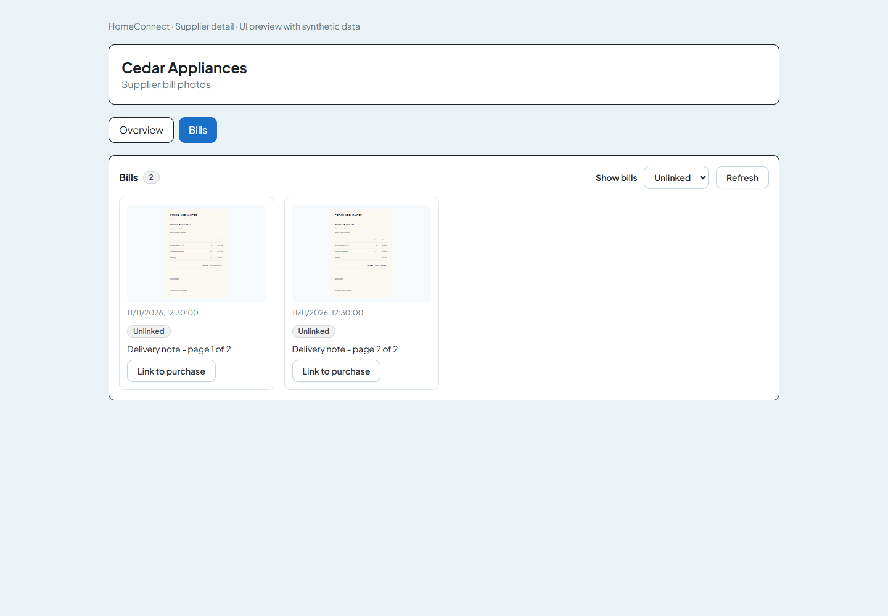
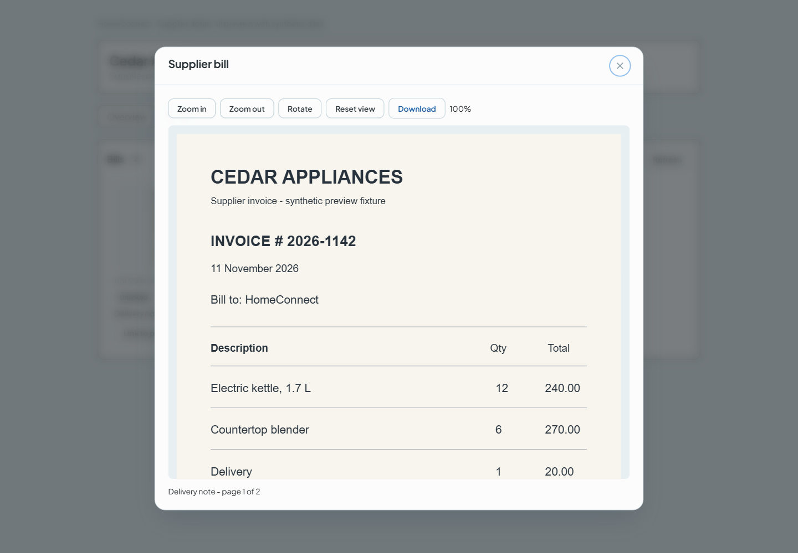
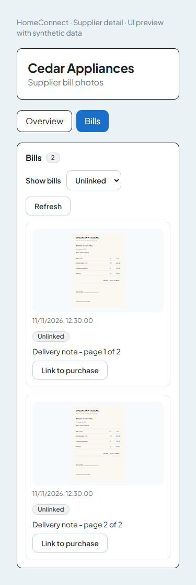

# Fix supplier bill photo capture, persistence, and desktop viewing

Supplier bill photos now use a compressed JPEG and native binary upload. Operators can capture several pages, choose gallery images, add a note, and save a bill before a purchase exists. Each page is a separate receipt row. The desktop supplier Bills tab displays those pages and links unlinked bills to a receiving-backed purchase.

Base: `develop`. Branch: `feat/mobile-bill-photos-fix`. Mobile version: `1.1.0`, Android version code: `3`.

## Reproduction notes

The requested pre-change real-camera reproduction could not be performed: no Android device, emulator, or Android SDK was available in this environment. These are source findings, not device observations:

- Capture previously used `skipProcessing: true`, retaining full-resolution camera output without the requested orientation processing. The server rejected bodies over 5 MB with 413.
- Upload previously used `fetch(localUri).blob()` followed by a fetch body. Its Android reliability could not be measured here.
- Upload failures displayed a generic local-save message. Entries left `uploading` were excluded from the pending list.
- The purchases picker received financial ledger entries, while receipt upload expected inventory receiving IDs. The global purchase guard could reject a valid receiving ID before receipt handling. The new receipt handler accepts either ID and checks its receiving's branch. Mobile maps the purchase response to its optional receiving ID.

## Resulting behavior

- Camera processing remains enabled. Camera and gallery pages share a JPEG preparation path: maximum long edge 2000 px, quality 0.7, with a smaller second pass for unusually large images. The size target is under 1.5 MB.
- Upload uses `expo-file-system/legacy.uploadAsync`, binary POST, JPEG content type, authentication and branch headers, a shared JSON-envelope/error parser, and a 60-second UI timeout. A retry joins a native transfer that outlives the timeout. A stable `X-Receipt-Id` deduplicates a retry after process death or a lost response.
- The persistent queue migrates `updatedAt`, recovers uploads older than two minutes, shows current uploads, serializes flushes and index mutations, and atomically replaces its index on the device. Network and 5xx failures remain retryable. Rejected entries are blocked with the server message. Login/foreground synchronization waits for a validated branch. New entries retain their original server and branch.
- Pending bills provides thumbnails, labels, status, last error, Retry, Delete, and Change purchase. Older entries without a saved supplier can select one while changing purchase.
- Desktop Bills provides Unlinked / Linked / All filters, refresh, thumbnails, linking, and a full-size viewer with zoom, rotation, panning, and download. Receiving details have an Attached bills strip and count. Images use an authenticated fetch followed by `URL.createObjectURL`; object URLs are revoked on cleanup. Credentials never appear in image URLs.

## Migration SQL

`20261111120000_supplier_bills_inbox` runs in a transaction:

1. Add nullable `supplierId`, `branchId`, and `note` columns.
2. Backfill supplier and branch from each linked receiving.
3. Abort atomically with an actionable message if a legacy photo's receiving has no supplier. Assign those receivings a supplier before retrying. No supplier is invented and no receipt is discarded.
4. Set ownership columns `NOT NULL` and permit a null receiving. The existing receiving FK and its delete action remain intact.
5. Add supplier/branch FKs, `(supplierId, capturedAt)` and branch indexes, and the `SupplierReceiptBlob` table with cascading receipt ownership.

No tables, columns, or receipt data are dropped and there is no destructive backfill default. A PostgreSQL test exercises migration failure/rollback, backfill, preserving the original filename/size, unlinking, and blob cascade deletion.

New uploads use database storage when `HOSTED_MODE=true` or `RECEIPT_STORAGE=db`; otherwise they use disk storage. Database row/blob creation is transactional. Existing disk rows retain their filenames and can still be read when their files are present. The existing disk snapshot/restore implementation remains compatible. Database blobs are included in database backups. Existing hosted disk files are not automatically imported into the database; preserve those files before replacing an old hosted instance.

## Gateway diff

The exact method/path allow-list adds:

| Method | Path |
| --- | --- |
| GET | `/api/v1/supplier-purchases/:id/receipts` |
| POST, GET | `/api/v1/suppliers/:id/bills` |
| PATCH, DELETE | `/api/v1/supplier-bills/:id` |
| GET | `/api/v1/supplier-bills/:id/image` |

The gateway also forwards `X-Receipt-Id` and response `Cache-Control`, and its upstream timeout is 60 seconds. Tests cover these routes, raw byte preservation, branch/auth headers, excluded cookies/scanner credentials, unsupported methods, and non-allow-listed paths.

Every bill route requires authentication and branch scope. Linking verifies the receiving's supplier and branch. Image responses send the stored MIME and `Cache-Control: private, max-age=86400`. Disk paths accept only server-generated filenames. Deletion uses the shared role middleware for ADMIN/MANAGER; the current Prisma role enum contains ADMIN and EMPLOYEE.

## Validation

- Mobile typecheck: passed.
- Mobile tests: 79 passed across 16 files.
- Mobile lint: passed; one existing array-type warning in `src/api/supplier-purchases-api.ts`.
- Frontend and backend TypeScript checks: passed.
- Lint for the new receipt/backend and Bills/frontend files: passed.
- Targeted routes, gateway, disk snapshot, driver unit, backfill, and Bills component tests: passed in checkpoints. The hosted storage integration tests also verify database persistence across a storage-mode change, upload deduplication, blob deletion, and transactional rollback on blob-write failure.
- Browser fixture checks: passed for authenticated image fetching, filtering, opening, zoom, rotation, Escape-to-close, and linking. No browser errors or horizontal overflow at 375 px.
- `npm run test:ci`: passed — 443 files, 3,637 tests, zero skipped files or tests.
- `graphify update .`: graph regenerated after code changes. A per-process Git excludes override was needed because the sandbox cannot read the user's global ignore file; no global Git configuration was changed.

## Screenshots

These are browser renders of the implemented Bills component using synthetic supplier/invoice fixtures. They are not phone or production-data screenshots.

Phone capture and Pending bills screenshots remain unavailable because there is no Android runtime here.

## Remaining verification

- Real full-resolution camera photo upload over the LAN gateway in Android debug.
- Android camera/gallery orientation, compressed size, and native binary-transfer behavior on hardware.
- Force-kill during an actual native upload, reopen, and confirm upload or visibility in Pending bills.
- Install and exercise the EAS internal APK, then confirm its photo appears on the PC within one refresh.
- The EAS build was attempted but automatic approval review rejected the source upload to Expo because of external data transfer and possible cloud-build credit use. No cloud build was started; explicit approval is needed to retry.

## Reviewer checklist

- [x] Backfill precedes `NOT NULL`; receipt data is preserved.
- [x] Branch checks cover new routes, including image streaming and linking.
- [x] No token in URLs; image MIME/cache headers and disk filename checks are tested.
- [x] Flushes serialize, retries carry stable identifiers, and blocked entries are excluded from auto-sync.
- [x] Existing disk filenames and snapshot/restore behavior are retained.
- [x] Gateway tests cover new paths and excluded paths/methods.
- [ ] Android debug and internal APK device acceptance checks completed.
